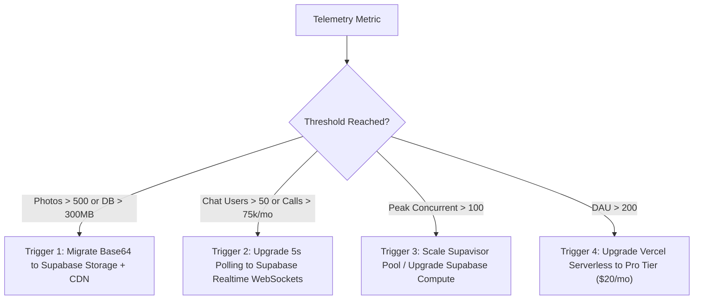

# Pal Matrimony — Project Intent & Strategic Guardrails
**Document Version:** 1.0.0  
**Living Contract Status:** ACTIVE  
**Canonical Domain:** https://gadariya.org (Secondary: https://gadariya-livid.vercel.app)  
**Last Updated:** 2026-11-03  

---

## 1. Project Vision & Core Identity

### 1.1 Target Domain & Purpose
Pal Matrimony (`gadariya.org`) is a dedicated, community-first matrimonial platform architected specifically for the **Pal (Gadaria, Baghel, Dhangar, Nikhar, Holkar)** community across India and the diaspora. The platform combines cultural dignity with modern privacy engineering, offering a bilingual interface (Devanagari Hindi & English) tailored to candidate-managed and family-managed matchmaking workflows.

### 1.2 Canonical Policies & Core Invariants
1. **Zero Unverified Contact Leakage:** Direct phone numbers, residential addresses, and raw emails are NEVER exposed in discovery feeds, public biodata profiles, search results, or API responses.
2. **Dual-Approval Bilateral Contact Exchange:** Contact numbers are disclosed if and only if both the sender and receiver have explicitly verified mutual consent (`status = 'BOTH_APPROVED'`).
3. **Family Manager Restrictions (Constraint C-06):** While family guardians can manage profiles and suggest matches, they are strictly prohibited by database constraints from disclosing candidate contact details or downloading raw identity documents without candidate authorization.
4. **End-to-End Privacy & Encryption:** 
   - Phone numbers are field-level encrypted at rest using AES-256-GCM with deterministic HMAC-SHA256 blind indexing.
   - Chat threads are strictly gated by mutual interest acceptance and encrypted at rest with AES-256-GCM.
   - Downloaded Biodata PDFs are digitally watermarked with the viewer's Public ID and timestamp to deter unauthorized circulation.
   - Full compliance with the India Digital Personal Data Protection (DPDP) Act 2025, including explicit consent withdrawal and right-to-erasure workflows (`/api/privacy/*`).

### 1.3 Current Baseline State
- **Production Edge:** Vercel Anycast edge network with custom domain `gadariya.org` (SSL TLS 1.3).
- **Database:** Supabase PostgreSQL cluster (`aws-0-ap-south-1.pooler.supabase.com:6543`, Transaction Mode).
- **Authentication:** Firebase Authentication (Phone SMS OTP + Google OAuth) in project `studio-1427447382-cd5d2`.
- **Admin Control Plane:** 5-tier moderation desk with stateless HMAC-SHA256 MFA cookie verification.
- **Preserved Real Data:** Real user `Sudhir` (`PAL100070`) intact and preserved in production.

---

## 2. Current Strategic Phase & Exit Criteria

### Current Phase: **Phase 1 — Foundation, Trust & Community Adoption**

The current priority is ensuring rock-solid data privacy, sub-second query latency, zero connection pooling exhaustion, and high community trust verification before opening broad organic acquisition funnels.

### Numerical Exit Criteria (Transition to Phase 2: Growth & Network Scale)
To exit Phase 1 and advance to Phase 2 (Growth Scaling), the platform must meet all of the following verifiable milestones:

| Category | Metric | Phase 1 Exit Threshold | Target (Phase 2 Goal) |
|---|---|---|---|
| **Member Base** | Total Verified Profiles | $\ge 500$ published profiles | 1,000+ active profiles |
| **Active Engagement** | Daily Active Users (DAU) | $\ge 50$ unique daily visitors | 100+ DAU |
| **Session Quality** | Average Dwell Time | $\ge 15$ minutes / user session | $\ge 30$ minutes / user session |
| **Trust Badging** | Mobile Phone Verified | $\ge 85\%$ of published profiles | $\ge 95\%$ |
| **Trust Badging** | Live Selfie Verified | $\ge 20\%$ of published profiles | $\ge 40\%$ |
| **System Reliability**| Unhandled 500/DB Errors | **0 errors** / 7 consecutive days | Zero tolerance |
| **Database Health** | Supavisor Pool Utilization | $< 35\%$ during peak hours | $< 50\%$ |
| **Web Vitals** | Core Web Vitals (Edge) | LCP $< 2.5s$, CLS $< 0.1$, INP $< 200ms$ | Top 10% mobile CWV |

---

## 3. Non-Negotiable Operational Guardrails

### 3.1 Production State & Database Preservation
- **Protected Real User:** Member profile `Sudhir` (`PAL100070`) and its associated records must NEVER be modified, deleted, overwritten, or disrupted.
- **Database Safety:** The production database cluster (`aws-0-ap-south-1.pooler.supabase.com`) must NEVER be subjected to destructive migrations (`DROP TABLE`, `TRUNCATE`, or unseeded schema resets).
- **Test Isolation:** All automated integration and E2E suites (`*.test.mjs`, Playwright) must generate dynamic UUID-based test users and clean up 100% of their test data using `t.after()` hooks. Zero test-row leakage is tolerated in production feeds.

### 3.2 Deployment Protocol (Local-First Vetting)
- **Zero Autonomous Production Pushing:** Unless explicitly instructed by the developer, NO agent or script may run `git push origin main` or trigger automatic production deployments.
- **Mandatory Local Vetting Pipeline:** All code changes must first be executed, tested, and verified locally:
  1. `npm run typecheck` (tsc --noEmit) $\rightarrow$ 0 errors.
  2. `npm test` $\rightarrow$ 47/47 tests passing across all 10 suites.
  3. `npm run test:e2e` $\rightarrow$ 11/11 browser journeys passing with zero console errors.
  4. Developer inspection and explicit approval before any push.

### 3.3 Editorial & Community Quality Standards
- No automated or unverified mock candidate profiles may be published without administrative review.
- Candidate bio text must pass pre-moderation screening for direct contact numbers, emails, or off-platform handles before being committed.
- 100% bilingual parity between `messages/en.json` and `messages/hi.json`. No raw translation keys (e.g., `register.name`, `manager.self`) may ever render in the UI.

### 3.4 Security & Secrets Protection
- Never commit private keys, `.secrets/`, `.env*.local`, Supabase service role keys, or Firebase service account tokens to version control.
- Ensure `.secrets/` is explicitly listed in `.gitignore`.

---

## 4. Active Sprint OKRs (Week 45, 2026)

- **OKR 1 (Stability & Quality):** Maintain 100% pass rate on all 47 unit/integration test suites and 11/11 Playwright browser E2E journeys.
- **OKR 2 (Database Connection Safety):** Zero `EMAXCONNSESSION` occurrences across all production routes (`/api/discovery`, `/api/profile`, `/api/auth/me`).
- **OKR 3 (Authentication Completeness):** Verify Google Sign-In interactive provider toggle in Firebase Console (`studio-1427447382-cd5d2`).
- **OKR 4 (Storage Architecture Planning):** Audit photo storage trajectory and validate image offloading strategy (Supabase Storage / CDN) before reaching 500 profile photos.

---

## 5. Architecture Inflection Triggers

The following numerical thresholds dictate when infrastructure and code patterns must evolve:

1. **Trigger 1 (Media Offloading):** When total stored profile photos in `public.profile_photos` exceed **500 items** (or total DB disk exceeds **300 MB**):
   - *Action:* Move image binaries out of PostgreSQL `TEXT` columns and into Supabase Storage S3 buckets with Edge CDN cache headers (`Cache-Control: public, max-age=604800, s-maxage=2592000`).
2. **Trigger 2 (Chat Real-Time Optimization):** When active concurrent chat threads exceed **50 users** (or monthly serverless function invocations exceed **75,000**):
   - *Action:* Replace client-side 5-second `setInterval(loadThread, 5000)` polling with Supabase Realtime WebSocket channel subscriptions (`supabase.channel('messages')`).
3. **Trigger 3 (Database Connection Scaling):** When concurrent peak users exceed **100**:
   - *Action:* Increase Supavisor transaction pool allocation from 15 to 30+, and audit query execution plans for discovery filters.
4. **Trigger 4 (Compute Tier Upgrade):** When DAU exceeds **200 users** spending 30 minutes daily:
   - *Action:* Transition Vercel from Hobby to Pro plan to prevent function execution timeouts and invocation throttling.

---

## 6. Weekly Trajectory Review Log (Append-Only)

| ISO Week | Review Date | Reviewer | Active KRs Status | Key Operational Outcomes |
|---|---|---|---|---|
| **2026-W45** | 2026-11-03 | Antigravity (Architect) | 4/4 ON TRACK | Initialized Intent-Driven Architecture, verified live production endpoints (gadariya.org), scheduled automated Monday weekly review loop. |
